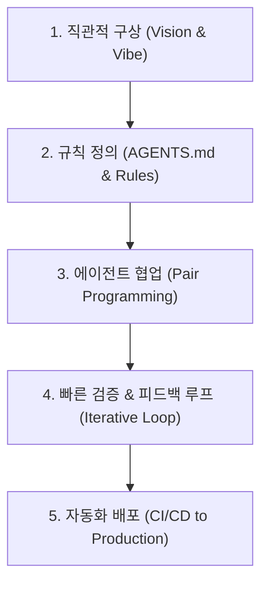

# 👤 About Kazan

안녕하세요! AI 에이전트와 함께 소프트웨어를 빠르게 구상하고 프로덕션으로 전환하는 **바이브 코더(Vibe Coder) Kazan**입니다.

복잡한 보일러플레이트에 얽매이지 않고, 직관적인 비전과 구조적 프롬프트 엔지니어링을 결합하여 가치 있는 도구와 서비스를 개발합니다.

---

## 🛠️ Tech Stack & Toolkit

=== "AI & Agents"
    * **AI Agents**: Google Antigravity, Claude 3.7 Sonnet, Gemini 3.8 Flash/Pro
    * **Protocols & Standards**: Model Context Protocol (MCP), Tool Use, Structured Output
    * **Workflows**: Multi-Agent Orchestration, Subagent Delegation, Memory/Rules Engineering

=== "Backend & Systems"
    * **Languages**: Python 3.11+, TypeScript, Bash / PowerShell
    * **Frameworks & Libs**: FastAPI, Jinja2, Pytest, Pydantic
    * **Automation & DevOps**: GitHub Actions, Docker, Cron, Windows Terminal

=== "Frontend & Design"
    * **Web**: HTML5, Modern CSS / Tailwind, MkDocs Material
    * **Graphics**: Pixel Art Automation, Sprite Atlases, SVG Diagrams, Mermaid.js

---

## ⚡ 바이브코딩 워크플로우 철학

1. **규칙 기반 에이전트 가이드 (Rules as Guardrails)**: AI에게 모든 것을 맡기는 것이 아니라, 명확한 제약 조건(Coding Rules, 해상도, 네이밍 컨벤션)을 사전 주입하여 퀄리티를 유지합니다.
2. **원스텝 자동화 지향**: 작성된 코드는 즉시 GitHub Actions를 통해 무중단으로 빌드되고 배포됩니다.
3. **학습과 기록의 선순환**: 에이전트와 나눈 최적의 프롬프트와 트러블슈팅 사례를 블로그에 즉시 아카이빙합니다.

---

## 📬 Contact & Links

* **GitHub**: [@swh0618-ux](https://github.com/swh0618-ux)
* **Email**: your-email@example.com
* **Community**: Discord / Dev Community
