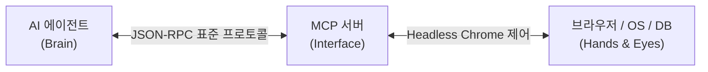

# AI 에이전트에게 손과 발을 달아주다: 브라우저 제어 & MCP 플러그인 제작기

> *"질문에 대답만 하는 AI를 넘어, 직접 브라우저를 열고 클릭하고 데이터를 추출하며 일하는 AI 에이전트를 만들 순 없을까?"*

많은 개발자들이 AI 챗봇과의 대화에 익숙해졌지만, 실무에서 우리가 마주하는 대다수의 작업은 **'웹사이트에 접속해서 버튼을 누르고, 결과를 확인하고, 파일을 다운로드하거나 설정을 변경하는 일'**입니다.

이번 포스팅에서는 **Antigravity의 플러그인 아키텍처**와 업계 표준인 **MCP(Model Context Protocol)**를 활용하여, AI 에이전트가 크롬(Chrome)이나 엣지(Edge)를 직접 제어하고 업무를 대행할 수 있는 플러그인 시스템을 구축한 과정을 공유합니다.

<!-- more -->

---

## 1. 배경: "말만 잘하는 AI"의 한계

LLM(대형 언어 모델)의 코딩 실력은 놀라운 수준에 도달했습니다. 하지만 일반적인 챗봇 형태의 AI는 다음과 같은 결정적인 한계를 지닙니다:

* **격리된 샌드박스**: 내가 만든 웹사이트가 실제로 브라우저에서 어떻게 렌더링되는지 눈으로 보지 못함.
* **조작 불가능**: 웹 어드민 콘솔에 들어가서 스위치를 켜거나, 폼을 입력하고 제출하는 상호작용이 불가능.
* **정적 데이터 의존**: 실시간 자바스크립트(SPA) 렌더링 웹페이지를 탐색하지 못함.

> "에이전트에게 눈(스크린샷)과 손(마우스 클릭, 타이핑)을 쥐여주자!"  
> 이를 현실로 만드는 열쇠가 바로 **플러그인과 MCP(Model Context Protocol)**였습니다.

---

## 2. MCP(Model Context Protocol)란 무엇인가?



**MCP(Model Context Protocol)**는 AI 모델이 외부 시스템(로컬 파일, 데이터베이스, 웹 브라우저, API)과 안전하고 표준화된 방식으로 통신할 수 있도록 설계된 개방형 프로토콜입니다.

과거에는 각 LLM마다 함수 호출(Function Calling) 규격이 제각각이었지만, MCP를 도입하면 하나의 브라우저 제어 서버(`@modelcontextprotocol/server-puppeteer`)를 만들어두고 다양한 에이전트에 플러그인처럼 꽂아서 즉시 사용할 수 있습니다.

---

## 3. 크롬 직접 제어 플러그인 구현: Puppeteer vs Playwright

브라우저 제어 플러그인을 설계할 때 가장 핵심적인 기술 선택지는 **Puppeteer**와 **Playwright**였습니다:

| 비교 항목 | Puppeteer MCP | Playwright MCP |
| :--- | :--- | :--- |
| **주요 지원 브라우저** | Chrome, Chromium 최적화 | Chrome, MS Edge, Firefox, WebKit 멀티 브라우저 |
| **설치 및 구동 속도** | 매우 빠르고 경량 | 브라우저 엔진 전체 번들링으로 다소 무거움 |
| **적합한 유즈케이스** | **웹 탐색, 캡처, 일반적 관리자 조작 (추천 ⭐)** | 크로스 브라우징 E2E 테스트, 복잡한 인증 우회 |

우리는 일상적인 웹 자동화와 대시보드 검증을 위해 가볍고 신속한 **Puppeteer MCP 플러그인**을 기본 채택하고, Microsoft Edge나 특수 환경 지원을 위해 **Playwright MCP**를 보조 옵션으로 구성했습니다.

---

## 4. 실전! 에이전트 브라우저 자동화 설정

Antigravity의 `mcp_config.json`에 단 몇 줄의 설정만 추가하면 에이전트에게 브라우저 조작 능력이 즉시 주입됩니다:

```json
{
  "mcpServers": {
    "puppeteer": {
      "command": "cmd.exe",
      "args": [
        "/c",
        "npx",
        "-y",
        "@modelcontextprotocol/server-puppeteer"
      ]
    }
  }
}
```

이제 에이전트에게 자연어로 다음과 같이 명령할 수 있습니다:

<div class="vibe-prompt-box">
  <div class="vibe-prompt-label">실제 에이전트 동작 프롬프트</div>
  "브라우저를 띄워서 https://kazan.pe.kr 에 접속해봐.<br>
  새로 배포된 'Vibe VPN 다운로드' 버튼이 정상적으로 화면에 보이는지 스크린샷을 찍고, 클릭 시 404 에러 없이 다운로드가 트리거되는지 검증해줘."
</div>

에이전트는 백그라운드에서 크롬을 띄우고, 마우스를 이동하여 버튼을 클릭하고, 네트워크 응답 상태(200 OK)를 검증한 뒤 우리에게 스크린샷과 함께 최종 보고를 회신합니다.

---

## 5. 플러그인이 가져온 바이브코딩의 진화

플러그인 시스템을 구축하면서 우리의 개발 워크플로우는 한 단계 더 진화했습니다:

1. **자동화된 시각적 QA**: 코드를 고치고 배포한 뒤, 개발자가 직접 브라우저를 열어 확인하지 않아도 에이전트가 전/후 화면을 캡처해 비교해 줍니다.
2. **콘솔 조작 자동화**: 도메인 DNS 설정이나 애드센스 검토 요청처럼 웹 UI를 클릭해야 하는 지루한 작업을 에이전트에게 안전하게 위임할 수 있습니다.
3. **무한한 확장성**: 브라우저뿐만 아니라 데이터베이스(Postgres/SQLite), 피그마(Figma), 클라우드(AWS/GCP)까지 MCP 플러그인으로 묶어 단일 대화창에서 통제할 수 있습니다.

---

## 6. 마치며

AI 에이전트의 진정한 잠재력은 텍스트 생성 능력 자체가 아니라, **그 지능을 실제 세상의 도구와 연결하는 확장성(Extensibility)**에 있습니다.

플러그인과 MCP는 AI를 단순한 조언자에서 **내 옆에서 실제로 컴퓨터를 조작해 주는 든든한 페어 프로그래머이자 디지털 동료**로 변모시키는 가장 강력한 다리입니다.

---

👉 **프로젝트 아키텍처 다이어그램과 세부 명세는 [Antigravity Plugins & MCP Suite 프로젝트 페이지](../../projects/antigravity-plugins.md)에서 확인하실 수 있습니다.**
