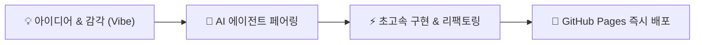

  <h1>⚡ KAZAN VIBE LAB</h1>
  

    생각의 속도로 빌드하는 <b>바이브코딩(Vibe Coding)</b> 아카이브. 
    AI 에이전트와의 밀도 높은 대화로 탄생한 실제 프로젝트와 테크 로그를 공유합니다.
  

  

    #VibeCoding
    #AgenticAI
    #PythonNative
    #GitHubPages
  

---

## 🔮 바이브코딩 선언 (The Vibe Manifesto)

> *"코드를 한 줄씩 타이핑하던 시대에서, 의도와 방향을 지휘하며 시스템을 오케스트레이션하는 시대로."*

전통적인 코딩이 벽돌을 한 장씩 쌓는 과정이었다면, **바이브코딩**은 아키텍처의 비전과 규칙을 제시하고 AI 에이전트와 호흡하며 빠른 속도로 프로토타입을 프로덕션으로 끌어올리는 창의적 실천입니다.

---

## 🚀 대표 프로젝트 (Pinned Highlights)

  

    Project
    <h3>Kazan Agent Hub</h3>
    

      다양한 특화 서브에이전트(기획, 코딩, 리서치)를 하나의 워크스페이스에서 유기적으로 연결하는 자율 협업 파이프라인.
    

    <a href="projects/kazan-agent-hub.md" class="md-button md-button--primary">프로젝트 상세보기 →</a>
  

  

    Tooling
    <h3>Item Asset Forge</h3>
    

      게임 아이템 그래픽을 프롬프트 하나로 생성하고 크로마키 투명화, 팔레트 양자화, 스프라이트 아틀라스 패킹까지 자동화하는 파이프라인.
    

    <a href="projects/item-asset-forge.md" class="md-button md-button--primary">프로젝트 상세보기 →</a>
  

---

## 📝 최신 기술 & 프롬프트 로그

* 📌 [**바이브코딩 시대를 맞이하며: AI와 페어 프로그래밍하는 새로운 워크플로우**](blog/posts/2026-10-22-welcome-vibe-coding.md) - 2026-10-22
* 💡 [모든 프로젝트 아카이브 둘러보기](projects/index.md)
* 👤 [Kazan의 프로필 및 기술 스택 확인하기](about.md)
