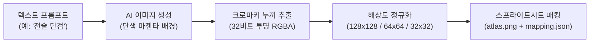

# ⚔️ Item Asset Forge

<div class="vibe-tags-row" style="justify-content: flex-start;">
  <span class="vibe-badge">Pillow</span>
  <span class="vibe-badge purple">AI Image Gen</span>
  <span class="vibe-badge">Sprite Atlas</span>
  <span class="vibe-badge">Python Pipeline</span>
</div>

---

## 📌 프로젝트 개요

**Item Asset Forge**는 2D/RPG/전술 시뮬레이션 게임에 필요한 아이템 그래픽을 프롬프트 기반으로 대량 생성하고, 후처리(크로마키 배경 투명화, 128/64/32px 정규화, 단일 스프라이트시트 패킹)를 원클릭으로 완료하는 파이썬 기반 에셋 파이프라인입니다.



---

## 💡 바이브코딩 프롬프트 레시피

<div class="vibe-prompt-box">
  <div class="vibe-prompt-label">Chroma Background Isolation Prompt</div>
  Tactical combat dagger, matte black titanium blade, serrated edge, carbon fiber grip, 45-degree angle pointing top-right. Rendered on solid pure chroma green (#00FF00) background, sharp edges, game inventory item icon style, no shadows on background, 8-bit rim light.
</div>

---

## 💻 크로마키 투명화 핵심 파이썬 스크립트

```python
from PIL import Image

def remove_chroma_background(img_path: str, output_path: str, tolerance: int = 40):
    """지정된 크로마 키(순수 녹색/마젠타) 색상을 투명 채널(Alpha 0)로 전환합니다."""
    img = Image.open(img_path).convert("RGBA")
    datas = img.getdata()
    
    new_data = []
    # 타겟 크로마 그린: RGB(0, 255, 0)
    for item in datas:
        r, g, b, a = item
        if g > 180 and r < 80 and b < 80:
            new_data.append((255, 255, 255, 0))  # 100% 투명
        else:
            new_data.append(item)
            
    img.putdata(new_data)
    img.save(output_path, "PNG")
    print(f"Alpha transparency applied: {output_path}")
```

---

## 🔗 관련 링크
* [아이템 갤러리 프리뷰](https://github.com)
* [GitHub Repository](https://github.com)
