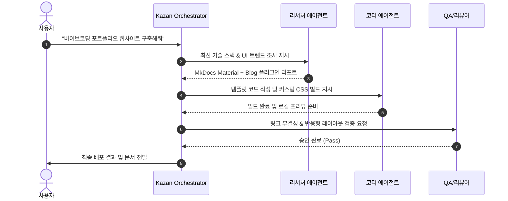

# 🤖 Kazan Agent Hub

<div class="vibe-tags-row" style="justify-content: flex-start;">
  <span class="vibe-badge">Python</span>
  <span class="vibe-badge">Multi-Agent</span>
  <span class="vibe-badge purple">MCP</span>
  <span class="vibe-badge">Antigravity</span>
</div>

---

## 📌 프로젝트 개요

**Kazan Agent Hub**는 복잡한 소프트웨어 개발 요구사항을 수신했을 때, 역할을 세분화한 다수의 서브에이전트(기획자, 리서처, 코더, QA)에게 작업을 위임하고 상호 메시징을 통해 결과를 종합하는 **자율 멀티에이전트 오케스트레이터**입니다.



---

## 💡 바이브코딩 프롬프트 레시피 (Prompt Recipe)

이 프로젝트를 빌드할 때 에이전트에게 전달했던 핵심 시스템 프롬프트 패턴입니다.

<div class="vibe-prompt-box">
  <div class="vibe-prompt-label">System Prompt Pattern</div>
  당신은 Kazan Agent Hub의 코어 오케스트레이터입니다.<br>
  1. 단일 대화창에서 모든 문제를 풀려 하지 말고, 작업의 성격(탐색/구현/검증)에 따라 하위 에이전트를 선별 호출하십시오.<br>
  2. 에이전트 간의 통신은 엄격히 정의된 JSON 스키마를 준수해야 합니다.<br>
  3. 모든 산출물은 `git` 추적이 가능한 파일 형태로 영속화하십시오.
</div>

---

## 💻 핵심 아키텍처 스니펫

```python
from dataclasses import dataclass
from typing import List, Optional

@dataclass
class AgentTask:
    task_id: str
    role: str
    instruction: str
    context_files: List[str]
    timeout_sec: int = 120

class KazanOrchestrator:
    def __init__(self, workspace_path: str):
        self.workspace = workspace_path
        self.active_agents = {}

    def dispatch(self, task: AgentTask) -> dict:
        """하위 전문 에이전트를 가상 샌드박스에서 구동하고 결과를 비동기 수신합니다."""
        print(f"[Hub] Dispatching {task.role} for task {task.task_id}...")
        # Agent execution loop
        return {"status": "SUCCESS", "artifacts": ["site/index.html"]}
```

---

## 🔗 관련 링크
* [GitHub Repository](https://github.com)
* [실시간 로그 보기](https://github.com)
