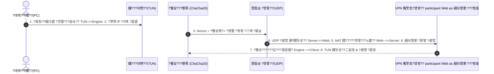

---
title: Python Vibe VPN
description: Python怨?珥덇퀬???뷀샇??ChaCha20-Poly1305) 湲곕컲??留욎땄??媛€???ъ꽕留?VPN) ?곕꼸 援ъ텞
---

# ?썳截?Python Vibe VPN (PyTunnel)

<div class="vibe-tags-row" style="justify-content: flex-start;">
  <span class="vibe-badge">Python 3.11</span>
  <span class="vibe-badge purple">ChaCha20-Poly1305</span>
  <span class="vibe-badge">Asyncio UDP</span>
  <span class="vibe-badge">TUN Adapter</span>
  <span class="vibe-badge purple">Vibe Coding</span>
</div>

---

## ?뱦 ?꾨줈?앺듃 媛쒖슂

**Python Vibe VPN**?€ ?곸슜 VPN??臾닿굅??諛깃렇?쇱슫???쒕퉬?ㅼ? 遺덊븘?뷀븳 ?먭꺽 痢≪젙(Telemetry)??諛곗젣?섍퀬, **?ㅼ쭅 蹂댁븞 ?듭떊怨??띾룄?먮쭔 吏묒쨷??珥덇꼍??媛쒖씤 留욎땄??媛€???ъ꽕留?VPN) ?곕꼸**?낅땲??

Python??`asyncio` 鍮꾨룞湲?I/O?€ ?꾨? ?뷀샇???쒖???`ChaCha20-Poly1305` AEAD瑜?寃고빀?섏뿬, 媛€???ㅽ듃?뚰겕 ?대뙌??TUN/Wintun)濡쒕????좎엯?섎뒗 IP ?⑦궥??罹≪뒓?뷀븯怨??덉쟾?섍쾶 ?먭꺽 ?쒕쾭濡??곕꼸留곹빀?덈떎.



---

## ?뮕 諛붿씠釉뚯퐫???꾨＼?꾪듃 ?덉떆??(Prompt Recipe)

???꾨줈?앺듃瑜???30遺?留뚯뿉 ?꾨줈?좏??댄븨????AI ?먯씠?꾪듃?€ ?섎늿 ?듭떖 ?꾨＼?꾪듃 ?붿??덉뼱留??⑦꽩?낅땲??

<div class="vibe-prompt-box">
  <div class="vibe-prompt-label">System Architecture Prompt</div>
  Python 3.11怨?asyncio瑜??ъ슜?섏뿬 鍮꾨룞湲?UDP 湲곕컲 VPN ?곕꼸???ㅺ퀎?⑸땲??<br>
  1. TCP over TCP 吏€??臾몄젣瑜?諛⑹??섍린 ?꾪빐 ?꾩넚 怨꾩링?€ 臾댁“嫄?UDP瑜?梨꾪깮?⑸땲??<br>
  2. ?뷀샇?붾뒗 cryptography ?쇱씠釉뚮윭由ъ쓽 ChaCha20Poly1305瑜??ъ슜?섎ʼn, 留??⑦궥留덈떎 ?좊땲?ы븳 96-bit Nonce瑜??먮룞 ?앹꽦?⑸땲??<br>
  3. MTU???⑦궥 ?⑦렪??Fragmentation)瑜?諛⑹??섎룄濡?湲곕낯 1420 諛붿씠?몃줈 ?쒗븳?섍퀬, ?⑦궥 ?ㅻ뜑 援ъ“??[4諛붿씠??留ㅼ쭅?섎쾭 | 12諛붿씠??Nonce | N諛붿씠???뷀샇臾?| 16諛붿씠??MAC ?쒓렇]濡?吏곷젹?뷀븯??떆??
</div>

---

## ?뮲 ?듭떖 援ы쁽 肄붾뱶 (Core Engine)

VPN ?대씪?댁뼵?몄? ?쒕쾭 媛꾩쓽 ?뷀샇???곕꼸 ?듭떊???대떦?섎뒗 鍮꾨룞湲?肄붿뼱 紐⑤뱢?낅땲??

```python
import os
import asyncio
from cryptography.hazmat.primitives.ciphers.aead import ChaCha20Poly1305

class VibeTunnelProtocol(asyncio.DatagramProtocol):
    MAGIC_HEADER = b"VIBE"

    def __init__(self, pre_shared_key: bytes, on_packet_received):
        self.cipher = ChaCha20Poly1305(pre_shared_key)
        self.on_packet_received = on_packet_received
        self.transport = None

    def connection_made(self, transport):
        self.transport = transport
        print("[VPN Tunnel] 鍮꾨룞湲?UDP ?곕꼸 ?뚯폆???쒖꽦?붾릺?덉뒿?덈떎.")

    def datagram_received(self, data: bytes, addr):
        # 1. ?ㅻ뜑 寃€利?        if len(data) < 32 or not data.startswith(self.MAGIC_HEADER):
            return  # ?섎せ???⑦궥 利됯컖 ?먭린 (怨듦꺽 李⑤떒)

        # 2. Nonce 遺꾨━ 諛?蹂듯샇??        nonce = data[4:16]
        ciphertext_and_tag = data[16:]
        try:
            raw_ip_packet = self.cipher.decrypt(nonce, ciphertext_and_tag, None)
            # 3. 媛€??TUN ?명꽣?섏씠?ㅻ줈 蹂듯샇?붾맂 IP ?⑦궥 二쇱엯
            self.on_packet_received(raw_ip_packet)
        except Exception:
            # 蹂€議곕릺嫄곕굹 ?ㅺ? 留욎? ?딅뒗 ?⑦궥 ?쒕∼
            pass

    def send_packet(self, raw_ip_packet: bytes, target_addr):
        # 臾댁옉??12諛붿씠??Nonce ?앹꽦 ??AEAD ?뷀샇??        nonce = os.urandom(12)
        encrypted_payload = self.cipher.encrypt(nonce, raw_ip_packet, None)
        # ?⑦궥 議고빀: [MAGIC | NONCE | PAYLOAD]
        wire_data = self.MAGIC_HEADER + nonce + encrypted_payload
        self.transport.sendto(wire_data, target_addr)
```

---

## ??二쇱슂 湲곗닠???쒖젣?€ ?닿껐 怨쇱젙

=== "TCP Meltdown 諛⑹?"
    * **臾몄젣**: SSH ?곕꼸?대굹 TCP ?곕꼸留곸쓣 ?ъ슜??寃쎌슦, ?대? TCP?€ ?몃? TCP???ъ쟾???€?대㉧媛€ 異⑸룎?섏뿬 ?€??룺??湲됯꺽???€?섎릺??*TCP-in-TCP Meltdown* ?꾩긽 諛쒖깮.
    * **?닿껐**: 諛붿씠釉뚯퐫??珥덇린 湲고쉷 ?④퀎?먯꽌 ?꾩넚 ?덉씠?대? **?쒖닔 UDP ?뚯폆**?쇰줈 怨좎젙?섍퀬, ?좊ː??蹂댁옣?€ 理쒖긽???좏뵆由ъ??댁뀡 ?꾨줈?좎퐳???쇱엫.

=== "MTU 諛??⑦궥 ?⑦렪??
    * **臾몄젣**: ?쒖? Ethernet MTU(1500) ?⑦궥???뷀샇???ㅻ뜑(MAGIC 4B + Nonce 12B + Tag 16B = 32B)媛€ 異붽??섎㈃ 1500??珥덇낵?섏뿬 以묎컙 ?쇱슦?곗뿉???⑦궥 ?⑦렪?붽? 諛쒖깮.
    * **?닿껐**: 媛€??TUN ?μ튂??MTU瑜?**1420**?쇰줈 ?ㅼ젙?섏뿬 WireGuard ?쒖? ?섏????ㅻ뱶猷??뺣낫.

=== "?ъ쟾??怨듦꺽(Replay Attack) 諛⑹?"
    * **臾몄젣**: 以묎컙??MITM)媛€ ?뷀샇?붾맂 ?뺤긽 ?⑦궥???꾩껌 ???ъ쟾?≫븷 ?꾪뿕.
    * **?닿껐**: 12諛붿씠??Nonce???€?꾩뒪?ы봽 湲곕컲 ?щ씪?대뵫 ?덈룄???쒗€€?ㅻ? 寃고빀?섏뿬 ?댁쟾 ?⑦궥 ?섏떊 ??臾댁“嫄?嫄곗젅?섎룄濡??ㅺ퀎.

---

## ?뱿 諛고룷 ?뚯뒪肄붾뱶 ?⑦궎吏€ ?ㅼ슫濡쒕뱶

<div class="vibe-card" style="border-left: 4px solid #00e5ff; margin: 2rem 0; background: rgba(18, 22, 36, 0.85);">
  <span class="vibe-badge">v1.0.0 Stable</span>
  <h3 style="margin-top: 0.5rem;">?벀 Python Vibe VPN ?꾩껜 ?뚯뒪肄붾뱶 ?⑦궎吏€</h3>
  <p>
    ?대씪?댁뼵??<code>client.py</code>), ?쒕쾭 寃뚯씠?몄썾??<code>server.py</code>), 256鍮꾪듃 ?€移?궎 ?앹꽦湲?<code>keygen.py</code>) 諛??ㅼ젙 ?쒗뵆由?<code>config.json</code>)??紐⑤몢 ?ы븿???뺤텞 ?뚯씪?낅땲??
  </p>
  <div style="margin: 1.5rem 0 1rem;">
    <a href="../assets/downloads/vibe-vpn-v1.0.0.zip" class="md-button md-button--primary" download>
      ??Vibe VPN v1.0.0 ?ㅼ슫濡쒕뱶 (.ZIP)
    </a>
  </div>
  <small style="color: var(--md-default-fg-color--light); display: block; font-family: var(--md-code-font-family); font-size: 0.8rem;">
    SHA-256: E66599C5F8CC9A0ABADCEE55BDDA4D875E46FD9C6281A2AFD3FDB84D4C1D54CF | ?ш린: ~4.0 KB
  </small>
</div>

---

## ?뵕 愿€??臾몄꽌 & ?꾨줈?앺듃
* [?뱷 諛붿씠釉뚯퐫?⑹쑝濡?VPN??媛쒕컻???꾩껜 ?ㅽ넗由?釉붾줈洹??쎄린](../signal/posts/2026-10-22-building-python-vpn-vibe-coding.md)
* [?뮲 Projects Overview濡??뚯븘媛€湲?(index.md)

