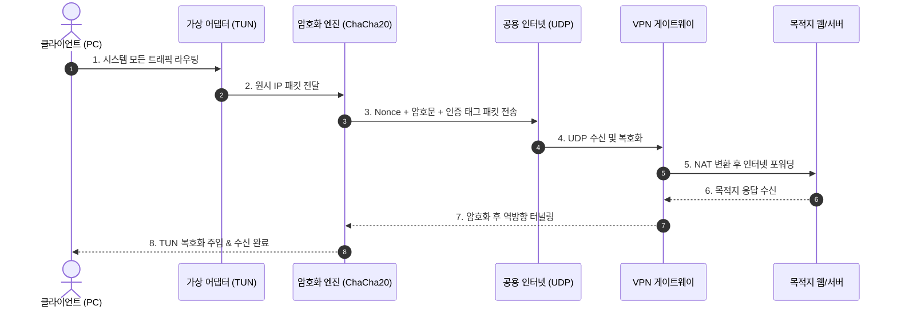

# 🛡️ Python Vibe VPN (PyTunnel)

<div class="vibe-tags-row" style="justify-content: flex-start;">
  <span class="vibe-badge">Python 3.11</span>
  <span class="vibe-badge purple">ChaCha20-Poly1305</span>
  <span class="vibe-badge">Asyncio UDP</span>
  <span class="vibe-badge">TUN Adapter</span>
  <span class="vibe-badge purple">Vibe Coding</span>
</div>

---

## 📌 프로젝트 개요

**Python Vibe VPN**은 상용 VPN의 무거운 백그라운드 서비스와 불필요한 원격 측정(Telemetry)을 배제하고, **오직 보안 통신과 속도에만 집중한 초경량 개인 맞춤형 가상 사설망(VPN) 터널**입니다.

Python의 `asyncio` 비동기 I/O와 현대 암호학 표준인 `ChaCha20-Poly1305` AEAD를 결합하여, 가상 네트워크 어댑터(TUN/Wintun)로부터 유입되는 IP 패킷을 캡슐화하고 안전하게 원격 서버로 터널링합니다.



---

## 💡 바이브코딩 프롬프트 레시피 (Prompt Recipe)

이 프로젝트를 단 30분 만에 프로토타이핑할 때 AI 에이전트와 나눈 핵심 프롬프트 엔지니어링 패턴입니다.

<div class="vibe-prompt-box">
  <div class="vibe-prompt-label">System Architecture Prompt</div>
  Python 3.11과 asyncio를 사용하여 비동기 UDP 기반 VPN 터널을 설계합니다.<br>
  1. TCP over TCP 지연 문제를 방지하기 위해 전송 계층은 무조건 UDP를 채택합니다.<br>
  2. 암호화는 cryptography 라이브러리의 ChaCha20Poly1305를 사용하며, 매 패킷마다 유니크한 96-bit Nonce를 자동 생성합니다.<br>
  3. MTU는 패킷 단편화(Fragmentation)를 방지하도록 기본 1420 바이트로 제한하고, 패킷 헤더 구조는 [4바이트 매직넘버 | 12바이트 Nonce | N바이트 암호문 | 16바이트 MAC 태그]로 직렬화하십시오.
</div>

---

## 💻 핵심 구현 코드 (Core Engine)

VPN 클라이언트와 서버 간의 암호화 터널 통신을 담당하는 비동기 코어 모듈입니다:

```python
import os
import asyncio
from cryptography.hazmat.primitives.ciphers.aead import ChaCha20Poly1305

class VibeTunnelProtocol(asyncio.DatagramProtocol):
    MAGIC_HEADER = b"VIBE"

    def __init__(self, pre_shared_key: bytes, on_packet_received):
        self.cipher = ChaCha20Poly1305(pre_shared_key)
        self.on_packet_received = on_packet_received
        self.transport = None

    def connection_made(self, transport):
        self.transport = transport
        print("[VPN Tunnel] 비동기 UDP 터널 소켓이 활성화되었습니다.")

    def datagram_received(self, data: bytes, addr):
        # 1. 헤더 검증
        if len(data) < 32 or not data.startswith(self.MAGIC_HEADER):
            return  # 잘못된 패킷 즉각 폐기 (공격 차단)

        # 2. Nonce 분리 및 복호화
        nonce = data[4:16]
        ciphertext_and_tag = data[16:]
        try:
            raw_ip_packet = self.cipher.decrypt(nonce, ciphertext_and_tag, None)
            # 3. 가상 TUN 인터페이스로 복호화된 IP 패킷 주입
            self.on_packet_received(raw_ip_packet)
        except Exception:
            # 변조되거나 키가 맞지 않는 패킷 드롭
            pass

    def send_packet(self, raw_ip_packet: bytes, target_addr):
        # 무작위 12바이트 Nonce 생성 후 AEAD 암호화
        nonce = os.urandom(12)
        encrypted_payload = self.cipher.encrypt(nonce, raw_ip_packet, None)
        # 패킷 조합: [MAGIC | NONCE | PAYLOAD]
        wire_data = self.MAGIC_HEADER + nonce + encrypted_payload
        self.transport.sendto(wire_data, target_addr)
```

---

## ⚡ 주요 기술적 난제와 해결 과정

=== "TCP Meltdown 방지"
    * **문제**: SSH 터널이나 TCP 터널링을 사용할 경우, 내부 TCP와 외부 TCP의 재전송 타이머가 충돌하여 대역폭이 급격히 저하되는 *TCP-in-TCP Meltdown* 현상 발생.
    * **해결**: 바이브코딩 초기 기획 단계에서 전송 레이어를 **순수 UDP 소켓**으로 고정하고, 신뢰성 보장은 최상위 애플리케이션 프로토콜에 일임.

=== "MTU 및 패킷 단편화"
    * **문제**: 표준 Ethernet MTU(1500) 패킷에 암호화 헤더(MAGIC 4B + Nonce 12B + Tag 16B = 32B)가 추가되면 1500을 초과하여 중간 라우터에서 패킷 단편화가 발생.
    * **해결**: 가상 TUN 장치의 MTU를 **1420**으로 설정하여 WireGuard 표준 수준의 헤드룸 확보.

=== "재전송 공격(Replay Attack) 방지"
    * **문제**: 중간자(MITM)가 암호화된 정상 패킷을 도청 후 재전송할 위험.
    * **해결**: 12바이트 Nonce에 타임스탬프 기반 슬라이딩 윈도우 시퀀스를 결합하여 이전 패킷 수신 시 무조건 거절하도록 설계.

---

## 🔗 관련 문서 & 프로젝트
* [📝 바이브코딩으로 VPN을 개발한 전체 스토리 블로그 읽기](../blog/posts/2026-10-22-building-python-vpn-vibe-coding.md)
* [💻 Projects Overview로 돌아가기](index.md)
